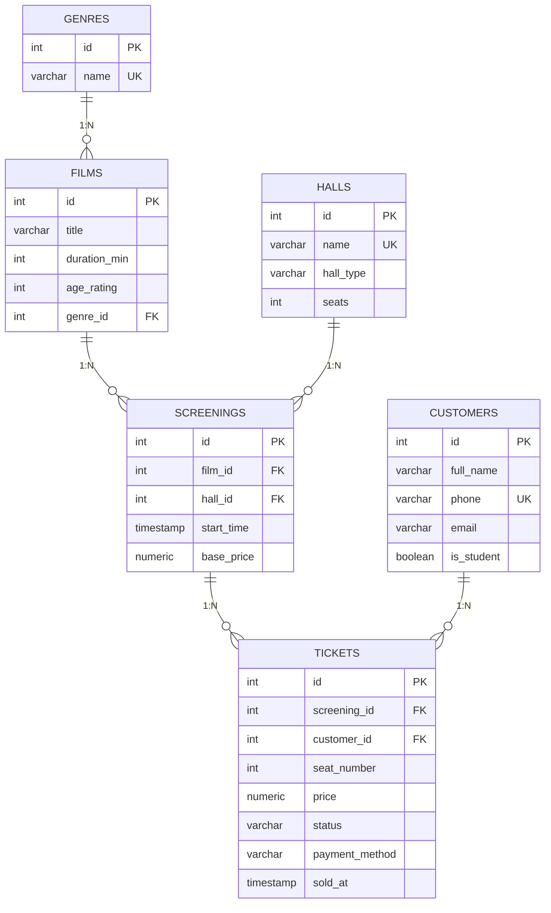
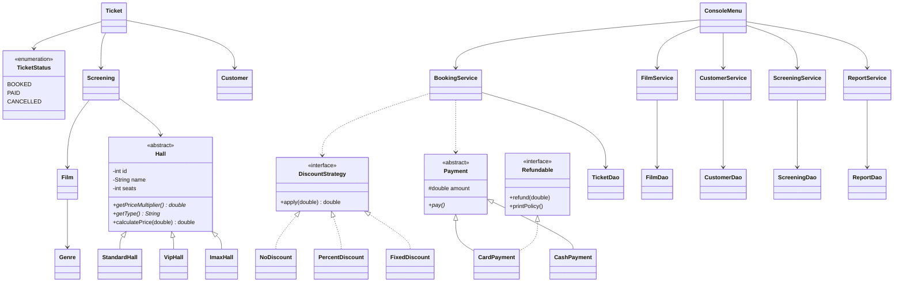

# Кинотеатр — курсовой проект по OOP and Databases

**Автор:** _Амантур Кадыров_ · **Группа:** _IEMIT-25_ · **Преподаватель:** Mr. Mutalip Osmanov
Ala-Too International University, Fall 2026

Консольное Java-приложение для кассы кинотеатра: фильмы, залы, сеансы, клиенты, продажа и отмена билетов, отчёты по выручке. Данные хранятся в PostgreSQL, Java подключается к базе через JDBC, весь SQL спрятан в слое DAO.

## Стек

| Компонент | Инструмент |
|---|---|
| Язык | Java 17 |
| IDE | IntelliJ IDEA Community |
| СУБД | PostgreSQL |
| Доступ к БД | JDBC (`PreparedStatement`) + DAO |
| Сборка | Maven |
| Тесты | JUnit 5 |
| Диаграммы | PlantUML (`docs/`) и Mermaid (ниже) |

## Что умеет программа

- **Фильмы** — полный CRUD: список, добавить, найти по названию, изменить, удалить.
- **Клиенты** — полный CRUD + поиск по имени или телефону.
- **Сеансы** — добавить, изменить время и цену, удалить, поиск по названию фильма (JOIN). Нельзя поставить сеанс в прошлое или на занятое время в том же зале.
- **Билеты** — бронирование места, оплата картой или наличными, отмена с возвратом денег. Одно место нельзя продать дважды.
- **Скидки** — студенческая 20% (только для студентов) и промокод `KINO100` (−100 сом).
- **Цена зависит от зала** — обычный x1.0, IMAX x1.3, VIP x1.5.
- **Отчёты** — выручка по фильмам (SUM, COUNT, GROUP BY), заполненность сеансов, постоянные клиенты (HAVING), фильмы без продаж (подзапрос), сохранение отчёта в файл `reports/report.txt`.
- **Валидация ввода** — в сеттерах моделей и при чтении с консоли; при ошибке программа пишет понятное сообщение и не падает.

## Как запустить

1. Установите **PostgreSQL** и запомните пароль пользователя `postgres`.
2. В pgAdmin или DBeaver создайте пустую базу **`cinema_db`** (или в psql: `CREATE DATABASE cinema_db;`).
3. Откройте папку проекта в **IntelliJ IDEA** (File → Open → выбрать папку с `pom.xml`). IDEA сама скачает зависимости Maven.
4. В файле `src/main/resources/db.properties` впишите свой пароль в `db.password`.
5. Запустите `src/main/java/kg/alatoo/cinema/Main.java` (зелёная кнопка ▶).

При первом запуске программа сама создаст таблицы (`schema.sql`) и добавит тестовые данные (`data.sql`).

Тесты: правый клик по папке `src/test/java` → Run 'All Tests' (или `mvn test`).

## Структура проекта (слои)

```
src/main/java/kg/alatoo/cinema/
├── Main.java            точка входа: собирает DAO → сервисы → меню
├── config/              AppConfig (Singleton), Database, DatabaseInitializer
├── model/               Genre, Film, Hall (abstract) + StandardHall/VipHall/ImaxHall,
│                        HallFactory, Screening, Customer, Ticket, TicketStatus (enum)
├── payment/             Payment (abstract), CardPayment, CashPayment,
│                        Refundable (interface), PaymentFactory
├── discount/            DiscountStrategy (interface), NoDiscount, PercentDiscount, FixedDiscount
├── dao/                 весь SQL: FilmDao, GenreDao, HallDao, ScreeningDao,
│                        CustomerDao, TicketDao, ReportDao
├── service/             правила: FilmService, ScreeningService, CustomerService,
│                        BookingService, ReportService
├── report/              строки отчётов: FilmRevenue, ScreeningOccupancy, CustomerStats
├── exception/           ValidationException, NotFoundException, DataAccessException
└── ui/                  ConsoleMenu, InputReader
src/main/resources/      db.properties, schema.sql, data.sql
src/test/java/           ModelTest, DiscountTest (JUnit 5)
docs/                    er-diagram.puml, class-diagram.puml, queries.sql
```

## Темы курса в коде

| Тема (неделя) | Где в проекте |
|---|---|
| Классы, конструкторы, перегрузка, `this(...)` (1) | `Film`, `Customer`, `Screening`: конструктор с id и без id |
| Инкапсуляция, геттеры/сеттеры с проверкой (1) | все поля `private`, проверки в сеттерах `Film`, `Customer`, `Hall` |
| `toString`, `equals`, `hashCode` (1) | во всех классах `model` |
| Коллекции `List`, композиция (2) | `Film` содержит `Genre`; `Screening` — `Film` и `Hall`; `Ticket` — `Screening` и `Customer` |
| Наследование, `super(...)`, `@Override` (3) | `Hall` → `StandardHall`, `VipHall`, `ImaxHall`; `Payment` → `CardPayment`, `CashPayment` |
| Полиморфизм, abstract class, interface, `instanceof` (4) | `Hall.calculatePrice()`, `Payment.pay()`, `Refundable`, проверка `instanceof Refundable` в `BookingService.cancel()` |
| Исключения, файлы, enum (5) | свои исключения в `exception/`, `TicketStatus`, `Files.writeString` в `ReportService` |
| UML, SOLID (6) | `docs/class-diagram.puml`; SRP — каждый слой отдельно; OCP — новая скидка = новый класс |
| Паттерны: Singleton, Factory, Strategy, DAO (7) | `AppConfig`, `HallFactory`, `PaymentFactory`, `DiscountStrategy`, пакет `dao` |
| БД, PK/FK, ER, 1:N и M:N, 3NF (9–10) | 6 таблиц, `tickets` — промежуточная таблица M:N между `customers` и `screenings` |
| DDL/DML, CHECK, UNIQUE, INDEX (11–12) | `schema.sql`, частичный уникальный индекс на место в зале |
| JOIN, агрегаты, GROUP BY, HAVING, подзапрос (12) | `ReportDao`, `ScreeningDao`, `docs/queries.sql` |
| Транзакции (13) | пример `BEGIN ... COMMIT` в `docs/queries.sql` |
| JDBC, `PreparedStatement`, без SQL injection (14) | все DAO; SQL никогда не склеивается со строкой пользователя |
| Слои Model / DAO / Service / UI (15) | пакеты `model`, `dao`, `service`, `ui` |

## ER-диаграмма

Нормализация: 1NF — все значения атомарные; 2NF — у таблиц простой ключ `id`; 3NF — нет транзитивных зависимостей (жанр, зал и клиент вынесены в свои таблицы, в `films` и `tickets` хранятся только внешние ключи).



## Class diagram



Полные диаграммы в формате PlantUML лежат в папке `docs/`. Открыть их можно в IntelliJ с плагином PlantUML Integration или на сайте plantuml.com.
